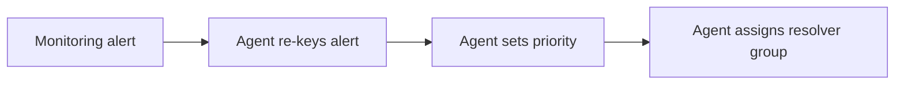

# Current state

| Field | Value |
|---|---|
| Analysis name | Current state |
| Kind | Current state |
| Initiative code | IMT |
| Version | 0.2 |
| Status | validated |
| Business analyst | Alex Rivera |
| Validated by | Head of IT Operations, Service Desk Lead |
| Validated on | 2026-10-21 |
| Confluence page | TBD |

## How incidents are handled today

Agents log incidents in the legacy ticketing tool, re-keying monitoring alerts by hand and choosing priority by judgement.

| Entry | Evidence | AI use | Reviewer |
|---|---|---|---|
| Monitoring alert: raised by the monitoring platform | IMT-FN-001 | AI-generated | Alex Rivera |
| Agent re-keys alert: about five minutes per alert | IMT-FN-002 | AI-generated | Alex Rivera |
| Agent sets priority: by judgement | IMT-FN-003 | AI-generated | Alex Rivera |
| Agent assigns resolver group: by hand | Assumption | AI-generated | Alex Rivera |

## SWOT

| Quadrant | Entry | Evidence | AI use | Reviewer |
|---|---|---|---|---|
| Strength | The department already has a priority matrix based on impact and urgency. | IMT-FN-004 | AI-generated | Alex Rivera |
| Weakness | Re-keyed alerts often carry mistyped configuration items. | IMT-FN-002 | AI-generated | Alex Rivera |
| Weakness | Incidents with the same impact get different priorities. | IMT-FN-003 | AI-generated | Alex Rivera |
| Threat | The legacy tool is out of vendor support. | Legacy ticketing tool end-of-support notice, 2026-03-31 | AI-assisted | Alex Rivera |

## Sources

| Document | Date | Owner role |
|---|---|---|
| Legacy ticketing tool end-of-support notice | 2026-03-31 | Head of IT Operations |

## Open questions

| # | Question | Findings involved | Ask | Answered by |
|---|---|---|---|---|
| 1 | Who assigns resolver groups today, and how? | Assumption | Service Desk Lead | — |
| 2 | Are critical monitoring alerts entered into the tool automatically or by hand? | Assumption | Service Desk Lead | IMT-FN-001 |

---
Produced with assess-current-state v0.1.0 in Claude Code, 2026-10-14.
Produced with assess-current-state v0.1.0 in Claude Code, 2026-10-18.
