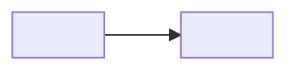

# Current state

| Field | Value |
|---|---|
| Analysis name | Current state |
| Kind | Current state |
| Initiative code | <CODE> |
| Version | 0.1 |
| Status | draft |
| Business analyst | <BA name> |
| Validated by | |
| Validated on | |
| Confluence page | TBD |

## Needs and problems

| Problem | Cause | Affected roles | Evidence | AI use | Reviewer |
|---|---|---|---|---|---|

## Processes

<optional "today" flow, up to about eight steps>

| Entry | Evidence | AI use | Reviewer |
|---|---|---|---|
| <step: what happens> | | | |

**Capabilities in scope** (as named in the business architecture team's capability map; leave out if the BA named none)

| Entry | Evidence | AI use | Reviewer |
|---|---|---|---|
| <capability, as named in the map> | <map title, date> | AI-assisted | |

## People and organisation

| Entry | Evidence | AI use | Reviewer |
|---|---|---|---|

## Technology and data

| Entry | Evidence | AI use | Reviewer |
|---|---|---|---|

## Policies and external constraints

| Entry | Evidence | AI use | Reviewer |
|---|---|---|---|

## Baseline measures

| Measure | Value | Unit | Period | Evidence | AI use | Reviewer |
|---|---|---|---|---|---|---|

## SWOT

| Quadrant | Entry | Evidence | AI use | Reviewer |
|---|---|---|---|---|

## PESTLE

<only if chosen>

| Factor | Entry | Evidence | AI use | Reviewer |
|---|---|---|---|---|

## Five forces

<only if chosen>

| Force | Entry | Evidence | AI use | Reviewer |
|---|---|---|---|---|

## Sources

| Document | Date | Owner role |
|---|---|---|

## Open questions

| # | Question | Findings involved | Ask | Answered by |
|---|---|---|---|---|

---
Produced with assess-current-state v<version> in <runtime>, <YYYY-MM-DD>.
