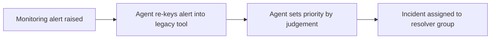

# Current state

| Field | Value |
|---|---|
| Analysis name | Current state |
| Kind | Current state |
| Initiative code | IMT |
| Version | 0.1 |
| Status | draft |
| Business analyst | Alex Rivera |
| Validated by | |
| Validated on | |
| Confluence page | TBD |

## Needs and problems

| Problem | Cause | Affected roles | Evidence | AI use | Reviewer |
|---|---|---|---|---|---|
| Agents re-key critical monitoring alerts into the ticketing tool by hand. | The legacy tool cannot be integrated with the monitoring platform. | Service desk agent | IMT-FN-001; Business need (unconfirmed) | AI-generated | |
| Re-keyed alerts often carry mistyped configuration items. | Manual re-keying. | Service desk agent | IMT-FN-002 | AI-generated | |
| Incidents with the same impact get different priorities. | Agents choose priority by judgement. | Service Desk Lead, Head of IT Operations | IMT-FN-003 | AI-generated | |
| Service-level breaches are found only after the fact. | TBD | Service Desk Lead, Head of IT Operations | Business need (unconfirmed) | AI-generated | |

## Processes

| Entry | Evidence | AI use | Reviewer |
|---|---|---|---|
| Monitoring alert raised: by the monitoring platform | IMT-FN-001 | AI-generated | |
| Agent re-keys alert into legacy tool: by hand, about five minutes per alert | IMT-FN-001; IMT-FN-002 | AI-generated | |
| Agent sets priority by judgement: no rule applied | IMT-FN-003 | AI-generated | |
| Incident assigned to resolver group: how is not known | Assumption | AI-generated | |

## People and organisation

| Entry | Evidence | AI use | Reviewer |
|---|---|---|---|
| Service desk agents log and work incidents, including those raised by monitoring alerts. | IMT-FN-001 | AI-generated | |
| Agents search past incidents several times a shift, mostly to reuse a known fix. | IMT-FN-011 (unconfirmed) | AI-generated | |
| Team leads get no warning before an incident breaches its resolution service level. | IMT-FN-007; Business need (unconfirmed) | AI-generated | |

## Technology and data

| Entry | Evidence | AI use | Reviewer |
|---|---|---|---|
| Incidents are handled in a legacy ticketing tool that is out of vendor support. | Business need (unconfirmed) | AI-generated | |
| The legacy tool cannot be integrated with the monitoring platform or the self-service portal. | Business need (unconfirmed) | AI-generated | |

## Policies and external constraints

| Entry | Evidence | AI use | Reviewer |
|---|---|---|---|
| The department has a priority matrix based on impact and urgency. | IMT-FN-004 | AI-generated | |
| Incident records may need to be kept for seven years. | IMT-FN-009 (unconfirmed) | AI-generated | |

## Baseline measures

| Measure | Value | Unit | Period | Evidence | AI use | Reviewer |
|---|---|---|---|---|---|---|
| Time to re-key a monitoring alert | about 5 | minutes per alert | TBD | IMT-FN-002 | AI-generated | |
| Incident search time | TBD | seconds | TBD | IMT-FN-008 | AI-generated | |
| Share of incidents breaching their resolution service level | TBD | % of incidents | TBD | Business need (unconfirmed) | AI-generated | |

## SWOT

| Quadrant | Entry | Evidence | AI use | Reviewer |
|---|---|---|---|---|
| Strength | The department already has a priority matrix based on impact and urgency. | IMT-FN-004 | AI-generated | |
| Weakness | Alerts are re-keyed by hand, often with mistyped configuration items. | IMT-FN-001; IMT-FN-002 | AI-generated | |
| Weakness | Incidents with the same impact get different priorities. | IMT-FN-003 | AI-generated | |
| Weakness | Team leads get no warning before a service-level breach. | IMT-FN-007 | AI-generated | |
| Opportunity | No evidence yet. | — | AI-generated | |
| Threat | The legacy tool is out of vendor support. | Business need (unconfirmed) | AI-generated | |

## Open questions

| # | Question | Findings involved | Ask | Answered by |
|---|---|---|---|---|
| 1 | Why are service-level breaches found only after the fact? | Business need (unconfirmed) | Service Desk Lead | — |
| 2 | How are incidents assigned to resolver groups today? | Assumption | Service Desk Lead | — |
| 3 | Over what period, and across how many alerts, was the five-minute re-keying time observed? | IMT-FN-002 | Service Desk Lead | — |
| 4 | How long does an incident search take today? | IMT-FN-008; IMT-FN-012 (unconfirmed) | Service Desk Lead | — |
| 5 | What share of incidents breach their resolution service level today, and over what period? | Business need (unconfirmed) | Head of IT Operations | — |
| 6 | Which external developments could the initiative use, such as monitoring platform or vendor features? Supply any vendor or market documents. | Assumption | Monitoring Engineer | — |

---
Produced with assess-current-state v0.1.0 in Claude Code, 2026-10-13.
